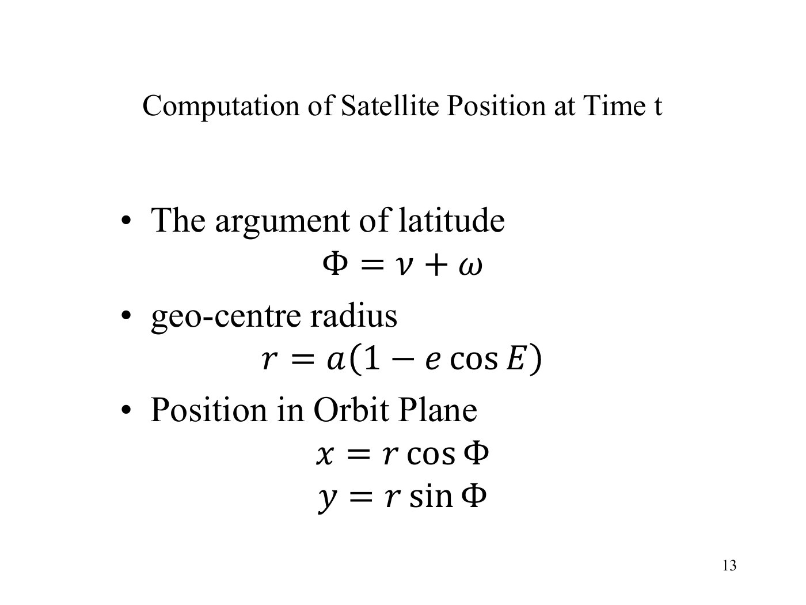
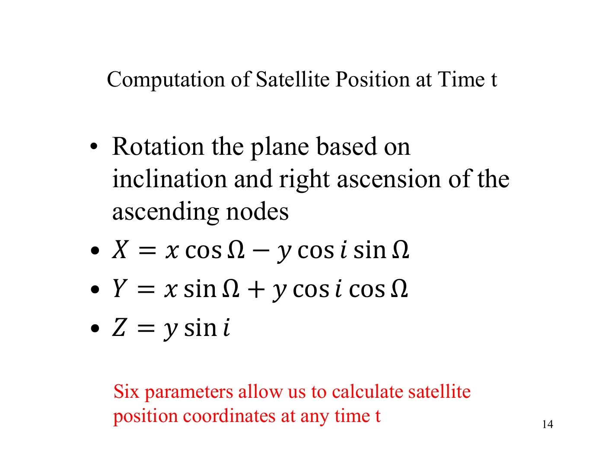
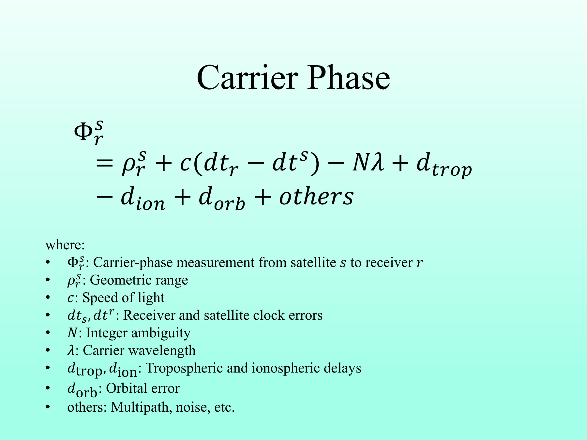
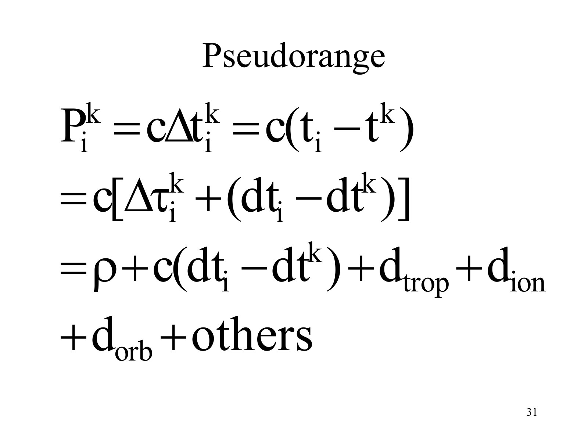
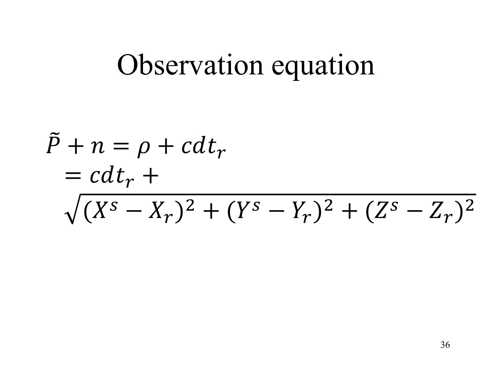
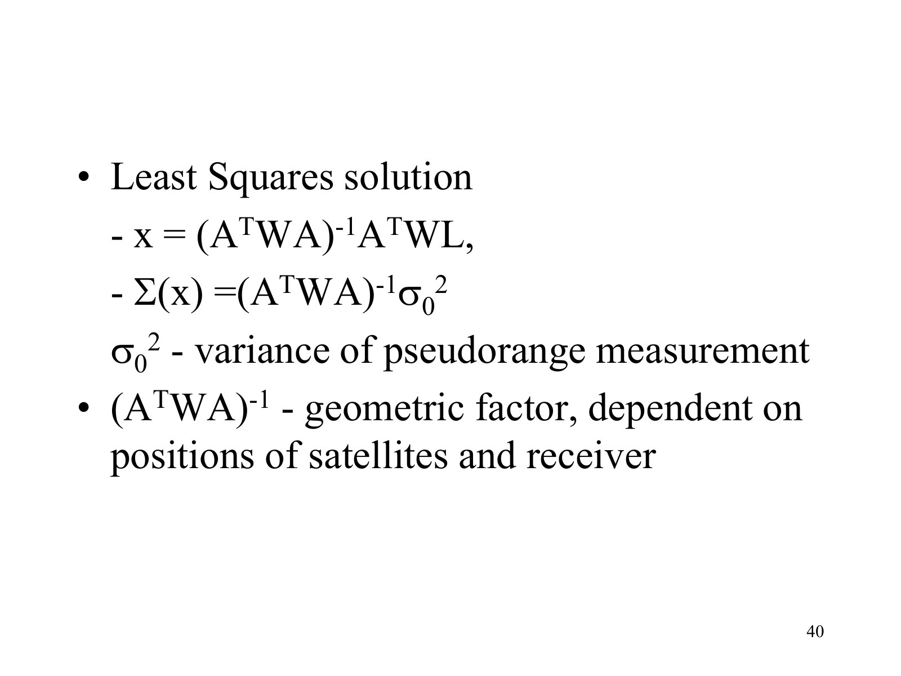

# From Satellite Signals to Receiver Coordinates: My Understanding of GPS Positioning

**Name:** Yuntao Xu (许云涛)  
**Student ID:** 26109261g  
**Course:** LSGI533  

### Markdown source

This report includes mathematical formulas and specialised symbols, which are easier to write and maintain in Markdown with LaTeX notation. This PDF was therefore converted from the Markdown source. The Markdown files and lecture-slide screenshots used in the report have been uploaded to GitHub: [My Understanding of GPS Positioning](https://github.com/xuytwinter/My-Understanding-of-GPS-Positioning).

## Contents

- [1. The positioning problem](#introduction)
- [2. GPS orbit coordinate computation and satellite clock error algorithms](#orbit-clock)
- [3. GPS observation equations: pseudorange, carrier phase, and Doppler](#observations)
- [4. Receiver positioning algorithms using pseudorange measurements](#receiver-positioning)
- [5. My overall understanding](#understanding)
- [References](#references)

## 1. The positioning problem

The question I want to understand from this course is how a receiver on the ground can calculate its position just by receiving signals from several satellites. Saying that it “measures distances to satellites” is only a starting point. I also need to understand how those distances are measured, where the satellites are, and whether the clocks at both ends refer to the same time standard.

In this report, I follow the process of obtaining a position. I start with how a signal provides distance information, then explain satellite position and clock calculations, examine what pseudorange, carrier phase and Doppler actually measure, and finally combine pseudorange observations into receiver coordinates. In my understanding, seeing how these steps depend on one another is what turns the lecture equations into a positioning method.

### 1.1 Start with one signal and one distance

Suppose a satellite sends a signal at GPS time \(t_s\), and a receiver receives it at \(t_r\). In an ideal vacuum, the travel time \(\tau=t_r-t_s\) gives a distance \(\rho=c\tau\). If the satellite position is known, that distance places the receiver on a sphere around the satellite. This gives the basic reason for using satellite signals: they supply distance constraints to reference points in space.

A real receiver does not directly obtain this ideal distance. It uses timing information at both ends to obtain an apparent travel time and multiplies it by light speed. This measurement is called pseudorange. Imperfect clocks and atmospheric propagation make it differ from geometric distance; Section 3 explains that difference through code measurement.

Even with a measured pseudorange, two geometric problems remain: the satellite moves, and one distance cannot uniquely determine position. I first establish where the reference satellite was at transmission, then address timing and observation errors, and finally combine several satellites' constraints to estimate receiver position.

### 1.2 Decide what the coordinates and times mean

The position I want to estimate is that of the ground receiver; satellite positions provide the references. Three Cartesian coordinates describe a position only when their reference frame is specified. Here I use an Earth-Centred, Earth-Fixed (ECEF) frame. Before subtracting satellite and receiver coordinates, I need a common frame. ECEF has its origin at the Earth's centre of mass; its \(Z\)-axis follows the rotation axis, and its \(X\)- and \(Y\)-axes lie in the equatorial plane and rotate with the Earth. WGS 84 supplies the terrestrial reference used for GPS positioning. Cartesian \(X,Y,Z\) describe a location in this frame; latitude, longitude and ellipsoidal height are another way to express that location.

The time labels must also refer to the same time system. I define each clock error as the clock reading minus GPS system time. Thus a positive receiver clock error means that the receiver clock reads ahead. This convention will explain the opposite receiver and satellite clock signs in the observation equation.

## 2. GPS orbit coordinate computation and satellite clock error algorithms

### 2.1 A satellite is moving, not a fixed reference point

To use a satellite as a reference, we need its coordinates when it transmitted the signal. A broadcast navigation message does not give one permanent \(X,Y,Z\) value. It gives orbital parameters that describe the satellite motion. The receiver uses these parameters to calculate the position at a requested time.

The lecture first describes the position in the orbital plane and then rotates it into a three-dimensional Earth-fixed frame.

I understand broadcast ephemeris as a set of parameters for calculating satellite position as a function of time. It is carried in the broadcast message, rather than inferred by the receiver from one pseudorange. The inputs are valid ephemeris parameters and the required GPS transmission time; the output is the satellite position at that time. The parameters describe the ellipse's size, shape, orientation and reference position, and the algorithm advances that description to the time we need.

This matters because the positioning equation needs a known reference point. A pseudorange constrains the relationship between the receiver and satellite; it cannot independently determine both positions. An error in the satellite reference coordinates may be absorbed into the receiver coordinates and clock estimate. Satellite position is therefore a direct input to receiver positioning, rather than just background information.

### 2.2 From orbital parameters to orbital-plane coordinates

I separate “how far the satellite has moved along its orbit” from “how that orbit is oriented in space.” The semi-major axis \(a\) describes the ellipse's size, and the eccentricity \(e\) describes its departure from a circle. Perigee is the point closest to the Earth's centre, and the ascending node is where the satellite crosses the equator from south to north. These meanings help explain the angle conversions that follow.

In the ideal two-body elliptical model, the mean motion is calculated from the semi-major axis:

$$
n=\sqrt{\frac{\mu}{a^3}}.
$$

Here \(a\) is the semi-major axis in \(\mathrm{m}\), and \(\mu=GM\) is the Earth's gravitational parameter in \(\mathrm{m^3\,s^{-2}}\). The result \(n\) is in \(\mathrm{rad\,s^{-1}}\). The mean anomaly advances with time:

$$
M=M_0+n(t-t_0).
$$

**Figure 1.** Original lecture slide: mean motion and mean anomaly, Lecture 4, p. 11.

The mean anomaly is convenient for progressing with time, but it is not yet the actual angle of the satellite on the ellipse. We therefore solve Kepler's equation:

$$
E-e\sin E=M.
$$

Here \(e\) is the dimensionless eccentricity, \(M_0\) is the mean anomaly at reference time \(t_0\), and all angles used in trigonometric functions are in radians. An eccentric orbit does not have a constant angular speed. The mean anomaly advances uniformly, while the eccentric anomaly \(E\) links that time description to the ellipse.

I can start with \(E_0=M\) and solve the equation numerically:

$$
E_{k+1}=E_k-\frac{E_k-e\sin E_k-M}{1-e\cos E_k}.
$$

I would stop when the change and the equation residual are sufficiently small. Next,

$$
\nu=\operatorname{atan2}\left(\sqrt{1-e^2}\sin E,\cos E-e\right),\quad
u_0=\nu+\omega,\quad r_0=a(1-e\cos E).
$$

The true anomaly \(\nu\) describes the actual orbital angle measured from perigee, and the argument of perigee \(\omega\) locates perigee relative to the ascending node. Consequently \(u_0\) locates the satellite from the ascending node within the orbital plane. The two-argument function \(\operatorname{atan2}\) preserves the correct angular quadrant.

**Figure 2.** Original lecture slide: true anomaly and eccentric anomaly, Lecture 4, p. 12.

**Figure 3.** Original lecture slide: argument of latitude, radius and orbital-plane coordinates, Lecture 4, p. 13.

### 2.3 Why the ideal ellipse needs broadcast corrections

The ellipse explains the basic geometry, but the real orbit is perturbed. GPS therefore broadcasts modified Keplerian parameters, including a mean-motion correction and harmonic corrections. In the broadcast calculation I use \(a=(\sqrt A)^2\), \(t_k=t-t_{oe}\), \(n=n_0+\Delta n\), and \(M=M_0+nt_k\), where \(t_{oe}\) is the ephemeris reference time. A time difference near the GPS week boundary must be adjusted consistently.

Here \(n_0=\sqrt{\mu/a^3}\) is the ideal mean motion above, and \(\Delta n\) is its broadcast correction. After solving for \(E\) and \(u_0\), the corrections are

$$
\begin{aligned}
\delta u&=C_{us}\sin 2u_0+C_{uc}\cos 2u_0,\\
\delta r&=C_{rs}\sin 2u_0+C_{rc}\cos 2u_0,\\
\delta i&=C_{is}\sin 2u_0+C_{ic}\cos 2u_0.
\end{aligned}
$$

Then \(u=u_0+\delta u\), \(r=r_0+\delta r\), \(i=i_0+\dot i\,t_k+\delta i\), and the orbital-plane coordinates are \(x=r\cos u\), \(y=r\sin u\). The radius coefficients have units of metres; the latitude and inclination coefficients are angular quantities. I understand these as corrections to the basic ellipse, not a separate positioning principle. The screenshots above show the lecture's basic geometry; these expanded broadcast steps follow the course tutorial.

### 2.4 From the orbital plane to ECEF coordinates

The orbital-plane coordinates are not yet the coordinates used with the receiver. They must be rotated using the orbital inclination \(i\) and a node direction angle \(\Omega\). In the broadcast ECEF algorithm, this must be the Earth-fixed node longitude, rather than the unmodified inertial right ascension:

$$
\begin{aligned}
X&=x\cos\Omega-y\cos i\sin\Omega,\\
Y&=x\sin\Omega+y\cos i\cos\Omega,\\
Z&=y\sin i.
\end{aligned}
$$

**Figure 4.** Original lecture slide: rotation into three-dimensional coordinates, Lecture 4, p. 14.

For GPS broadcast coordinates, the node longitude used in this rotation includes Earth rotation:

$$
\Omega=\Omega_0+(\dot\Omega-\omega_e)t_k-\omega_e t_{oe}.
$$

Here \(\Omega_0\) is the broadcast reference node parameter and \(\dot\Omega\) its rate of change. The Earth's rotation rate \(\omega_e\) differs from the argument of perigee \(\omega\). Similarly, \(i_0\) is the reference inclination and \(\dot i\) its rate of change. Angular rates are used in radians per second with time differences in seconds. The rotation equations alone do not define an Earth-fixed result unless the node angle uses the appropriate frame.

There is a second timing detail. The satellite coordinates refer to transmission, while the receiver coordinates refer to reception. The Earth rotates during the travel interval, so the satellite vector must also be expressed in the ECEF axes at reception before forming the range. This short propagation-time rotation is distinct from the Earth-rotation term in the broadcast node longitude (Lecture 4, p. 21).

In my opinion, the important idea is that a satellite coordinate is time-dependent and reference-frame-dependent. The satellite and receiver must be expressed in the same ECEF frame before their geometric distance can be calculated.

The orbit calculation now has a connected purpose: advance mean anomaly from the ephemeris reference time to transmission time, use Kepler's equation to locate the satellite on the ellipse, add the broadcast corrections, and use the orbital orientation and Earth rotation to express the result in common ECEF axes. In my understanding, all these angle conversions serve one goal: turning a broadcast description of the orbit into three coordinates usable in the positioning equation.

### 2.5 Satellite clock error algorithm

Knowing where the satellite is is still not enough. The receiver estimates signal travel time from the satellite transmit time and the receiver receive time. A small clock error becomes a large range-like error after multiplication by the speed of light. For example, \(1\,\mu\mathrm{s}\) corresponds to approximately \(300\,\mathrm{m}\).

A satellite uses a highly stable clock, but its reading is still not perfectly equal to GPS system time. I distinguish this from orbit error: orbit error makes the reference point inaccurate, whereas clock error makes the signal's time label inaccurate. Even with a correct orbit, an incorrect transmit timestamp biases the measured distance and can cause the orbit algorithm to use the wrong time.

The broadcast message supplies clock parameters, allowing the receiver to model the satellite clock error. This differs from the receiver clock error, which is estimated jointly with receiver position. The satellite-clock model is

$$
\delta t_s=a_{f0}+a_{f1}(t-t_{oc})+a_{f2}(t-t_{oc})^2+\Delta t_{\mathrm{rel}}.
$$

Here \(t_{oc}\) is the clock reference time. The coefficient \(a_{f0}\) is an offset in seconds, \(a_{f1}\) is the rate coefficient in \(\mathrm{s\,s^{-1}}\), and \(a_{f2}\) is the quadratic coefficient in \(\mathrm{s\,s^{-2}}\). Substituting the requested time gives the clock error in seconds. The relativistic correction is

$$
\Delta t_{\mathrm{rel}}=F e\sqrt A\sin E,
$$

where \(F\) is the prescribed GPS constant. It uses the eccentric anomaly already calculated in the orbit algorithm, so the clock and orbit computations share an intermediate result. The screenshot shows the polynomial; the relativistic term is expanded here using the course tutorial. For the basic GPS code correction, the broadcast group-delay parameter (TGD) must also be handled according to the signal and clock definition.

**Figure 5.** Original lecture slide: satellite clock error model, Lecture 4, p. 33.

I interpret the polynomial terms as the offset at the reference time, how quickly that offset changes, and how its rate changes. The broadcast \(a_{f2}\) is the quadratic coefficient; it should not be identified directly with the second derivative without accounting for the polynomial convention. The relativistic term adds a periodic contribution associated with the elliptical motion.

To calculate the correction, I select the applicable clock parameters and \(t_{oc}\), form the transmission-time difference in seconds, evaluate the polynomial, and use the orbit calculation's \(E\) for the relativistic term. The clock reference \(t_{oc}\) and orbit reference \(t_{oe}\) have different purposes and need not be equal. Week boundaries must also be handled consistently. The result \(\delta t_s\) is in seconds; only \(c\delta t_s\) is in metres.

The clock model has two linked uses. If the satellite-clock transmit tag is \(t_{s,\mathrm{clk}}\), then \(t_s=t_{s,\mathrm{clk}}-\delta t_s\) gives GPS transmission time for the orbit calculation. Meanwhile, the pseudorange equation contains \(-c\delta t_s\), so correcting the observation adds \(c\delta t_s\). This applies one clock model consistently to time conversion and observation modelling; it is not an arbitrary double correction to distance.

In my understanding, orbit and clock calculations work together: one provides the reference point's position, and the other associates that position and the range observation with the correct time.

## 3. GPS observation equations: pseudorange, carrier phase, and Doppler

We now have a way to model the satellite side. Next I return to the signal itself: what numbers does the receiver actually obtain? This is an order of explanation; the receiver acquires signals and observations before or while computing the satellite state. The three GPS observation types are pseudorange, carrier phase and Doppler. Their observation equations connect receiver measurements to the geometry we want to estimate and distinguish corrections, unknown parameters and remaining errors. In my understanding, they are three different ways of observing the same signal propagation process.

### 3.1 What pseudorange is and why it differs from geometric distance

**Pseudorange is the apparent signal travel time obtained from the ranging code, multiplied by the speed of light, and expressed in metres.** It resembles receiver-to-satellite distance but includes clock offsets, propagation delays and measurement errors. “Pseudo” therefore matters: the measured value is not automatically the geometric distance.

The receiver does not measure this with a physical ruler. It generates a local copy of the satellite's identifiable ranging code and shifts that copy in time to find the best match with the received code. This is code correlation. Since the code repeats, timing information from the signal is also needed to identify the corresponding transmission time. Together these give an apparent transmit-to-receive time interval.

First ignore hardware biases, noise and the atmosphere. Let the true GPS transmission and reception times be \(t_s,t_r\). The two clock readings are \(t_s+\delta t^s\) and \(t_r+\delta t_i\), so

$$
\begin{aligned}
P_i^s
&=c\left[(t_r+\delta t_i)-(t_s+\delta t^s)\right]\\
&=c(t_r-t_s)+c(\delta t_i-\delta t^s)\\
&=\rho_i^s+c(\delta t_i-\delta t^s).
\end{aligned}
$$

This explains the basic difference between pseudorange and geometric distance. Adding propagation and modelling errors gives the form discussed in the lecture:

$$
P_i^s=\rho_i^s+c(\delta t_i-\delta t^s)+T_i^s+I_i^s+d_{\mathrm{orb}}+\varepsilon_P.
$$

**Figure 6.** Original lecture slide: pseudorange observation equation, Lecture 2, p. 44.

Here \(\rho\) is the geometric distance, \(c\) is the speed of light, \(\delta t_i\) and \(\delta t^s\) are receiver and satellite clock errors, \(T\) and \(I\) are tropospheric and ionospheric delays, and \(\varepsilon_P\) includes noise, multipath and unmodelled effects. Thus pseudorange is not exactly the physical distance. It is a distance-like observation containing several errors.

Under my clock convention, the apparent time interval contains \(\delta t_i-\delta t^s\). A fast receiver clock increases pseudorange; a fast satellite clock increases the transmit timestamp and decreases pseudorange. The term \(d_{\mathrm{orb}}\) represents the range effect of using an imperfect computed satellite position. If \(\rho\) is defined using the true orbit, I would instead include that effect among the modelling errors, so it is not counted twice.

The atmosphere introduces another difficulty. The ionised part produces a frequency-dependent code delay, so dual-frequency observations can remove much of its first-order contribution. The neutral atmosphere also delays the signal and needs a tropospheric model. Reflected signals (multipath) follow extra paths and can distort tracking. These effects explain why clock correction alone cannot turn pseudorange into an exact distance (Lecture 3).

The subscript \(i\) identifies the receiver and superscript \(s\) the satellite; all terms are in metres. For a teaching example with only receiver clock error, a geometric distance of \(20\,200\,000\,\mathrm{m}\) and a receiver clock \(1\,\mu\mathrm{s}\) ahead give a pseudorange of approximately \(20\,200\,300\,\mathrm{m}\). The extra \(300\,\mathrm{m}\) is caused by the clock reading, not an actual increase in separation. A stable measurement can therefore still contain a common clock bias.

In my understanding, pseudorange matters because it provides a constraint usable in absolute positioning without first determining integer carrier cycles. However, it supplies an imperfect distance constraint rather than ready-made coordinates. The receiver must combine several satellites' observations and estimate its position and clock bias together.

### 3.2 Carrier phase: precise but ambiguous

Pseudorange already supplies a positioning constraint, but code measurement noise limits its precision. Can the receiver use finer changes in the same signal? It can also track the phase of the carrier wave. Carrier phase measures the phase relationship between the received carrier and a locally generated carrier, with phase changes accumulated during continuous tracking. One cycle corresponds to one wavelength, so multiplying phase in cycles by wavelength gives distance units. A phase comparison alone identifies a position within a cycle, however, not the complete number of cycles.

Its equation therefore retains the geometry, clocks and troposphere of the code model, adds an unknown integer-cycle term, and changes the ionospheric sign. Expressed in metres, a common model is

$$
\lambda\phi_i^s=\rho_i^s+c(\delta t_i-\delta t^s)+T_i^s-I_i^s-\lambda N_i^s+B_\phi+\varepsilon_\phi.
$$

**Figure 7.** Original lecture slide: carrier-phase observation equation, Lecture 2, p. 51.

In my understanding, the short carrier wavelength makes phase tracking very precise. However, the receiver does not initially know the integer number \(N\) of complete cycles between the satellite and receiver. This is the integer ambiguity. Cycle slips can also break the continuity of the phase. Therefore carrier phase provides high precision, but it needs additional ambiguity and data-quality processing.

Here \(\phi\) is measured in cycles and \(\lambda\) is the wavelength in \(\mathrm{m/cycle}\), so \(\lambda\phi\) is in metres. \(B_\phi\) groups phase hardware biases and \(\varepsilon_\phi\) groups residual errors. I retain the slide's \(-\lambda N\) convention. For continuous tracking, \(N\) stays constant, which is why differences in phase can reveal very small range changes. A loss of tracking can change that integer connection.

The first-order ionospheric term also changes from \(+I\) in code to \(-I\) in phase: the ionosphere delays the code group measurement but advances carrier phase. This does not mean that the signal carries information faster than light. It means that the code and carrier observables respond differently to the dispersive medium.

For example, the same fractional phase can accompany \(N\) complete cycles or \(N+1\) complete cycles. The fraction alone cannot distinguish those distances. A short wavelength helps measure small changes but does not remove the whole-cycle uncertainty. In my understanding, carrier phase is more than simply “a more accurate pseudorange”: precise position estimation must introduce and handle ambiguities for the continuous tracking arcs. A constant integer term cancels in time differences, but a cycle slip requires renewed handling.

### 3.3 Doppler: a range-rate observation

So far I have considered distance and its phase representation. To describe how the distance changes, I can instead examine the received carrier frequency's offset from its nominal frequency: Doppler. Under one common sign convention,

$$
D_i^s\approx-\frac{1}{\lambda}\left[\dot{\rho}_i^s+c(\dot{\delta t}_i-\dot{\delta t}^s)+\dot T_i^s-\dot I_i^s\right].
$$

**Figure 8.** Original lecture slide: the Doppler effect, Lecture 1, p. 13. The observation equation above is expanded using the course tutorial. The approaching source produces a higher received frequency and the receding source a lower one; the curve illustrates the change across the reference frequency.

Doppler mainly describes range rate, not absolute range. The geometric range rate is the relative velocity projected onto the satellite-receiver line of sight. Consequently, one Doppler observation does not determine the full three-dimensional velocity. Its sign must be checked against the receiver or RINEX convention.

The dots denote derivatives with respect to time. Range rate is in \(\mathrm{m\,s^{-1}}\); dividing by wavelength gives \(\mathrm{cycle\,s^{-1}}\), or Hz. With \(\mathbf{u}\) directed from receiver to satellite, \(\dot\rho=\mathbf{u}^{T}(\mathbf{v}_s-\mathbf{v}_r)\). Under the convention above, increasing range gives negative geometric Doppler. Even a stationary receiver observes Doppler because the satellite moves.

The Doppler equation can also be understood from the phase equation. During continuous tracking with constant \(N\), differentiating the phase model removes the constant integer term. Distance becomes range rate, and clock offset becomes clock drift. With the frequency convention used here, \(D=-\dot\phi\), giving the principal terms above. This simplified model neglects changes in phase hardware biases and measurement noise.

I understand Doppler's importance as adding “how the separation is changing” to “how far apart the two objects are.” With known satellite positions and velocities, several Doppler observations can estimate receiver velocity and clock drift jointly. One observation still supplies only one line-of-sight constraint. Doppler can support motion and tracking checks, but a single frequency shift is not an absolute distance.

These observations address different needs. Code supplies an initial absolute position; carrier phase supports more precise positioning after ambiguity handling (developed further in Lecture 6); Doppler describes the changing geometry and supports velocity estimation. For the receiver-position algorithm below I use pseudorange, as requested. Carrier phase and Doppler remain part of the measurement story, without pretending that they can be inserted unchanged into a code-only model.

The three observations therefore have different roles:

| Observation | Main information in my understanding | Main limitation |
|---|---|---|
| Pseudorange | Absolute range-like constraint | Larger noise and atmospheric effects |
| Carrier phase | Very precise phase-based range change | Integer ambiguity and cycle slips |
| Doppler | Line-of-sight range rate | Sign convention and clock drift |

## 4. Receiver positioning algorithms using pseudorange measurements

### 4.1 Why one satellite is not enough

If one satellite position and one exact distance were known, the receiver could only be located somewhere on a sphere around that satellite. One observation is therefore one geometric constraint, not a unique three-dimensional position.

The receiver position has three unknown coordinates. In addition, the receiver clock is not perfectly synchronised with GPS time, so the receiver clock bias is also unknown:

$$
\mathbf{x}=\begin{bmatrix}X_r&Y_r&Z_r&b_r\end{bmatrix}^{T},
\qquad b_r=c\delta t_r.
$$

This gives four main unknowns. That is why at least four geometrically independent satellites are normally required. Each satellite has its own position and clock model, while the receiver coordinates and clock bias are estimated jointly from their observations. This explains why I combine the satellite equations rather than calculate a separate receiver position from each satellite.

### 4.2 Form the corrected pseudorange equations

For each satellite, the receiver combines the measured pseudorange with the computed satellite coordinates, satellite-clock correction and available atmospheric corrections. A simplified corrected model is

$$
P^s_{\mathrm{corr}}=\rho^s(X_r,Y_r,Z_r)+b_r+\varepsilon^s_{\mathrm{res}}.
$$

**Figure 9.** Original lecture slide: pseudorange positioning equation, Lecture 4, p. 31.

I define \(P_{\mathrm{corr}}=P+c\delta t_s-T-I\), with other modelled biases handled consistently. The satellite clock term is added because it entered the original observation with a minus sign. The receiver clock bias stays unknown: it is shared by all simultaneous observations at that receiver. The term \(\varepsilon^s_{\mathrm{res}}\) represents remaining errors in metres; correction does not mean every measurement becomes exact.

How can I obtain a transmit time before knowing the receiver clock error? With a receiver-clock reception tag \(t_{r,\mathrm{clk}}\), I first form \(t_{s,\mathrm{clk}}\approx t_{r,\mathrm{clk}}-P/c\). The same receiver clock error is present in the tag and the pseudorange, so it cancels in this subtraction, giving an approximate satellite-clock transmission time. I then use \(t_s=t_{s,\mathrm{clk}}-\delta t_s\) to obtain GPS time; the satellite-clock model can be evaluated at an approximate time and refined. Thus orbit computation need not wait for a complete receiver-clock solution. Elevation-dependent atmospheric corrections do require a rough receiver position and are recomputed as it improves. The explanation separates these dependencies, while the algorithm checks their consistency in a loop.

The known inputs and unknowns are now clear. For each satellite, the inputs are a corrected pseudorange and satellite coordinates in the common frame. The shared unknowns are three receiver coordinates and one receiver clock bias in metres:

$$
P_{\mathrm{corr}}^s=
\sqrt{(X_s-X_r)^2+(Y_s-Y_r)^2+(Z_s-Z_r)^2}
+b_r+\varepsilon_{\mathrm{res}}^s.
$$

This connects the earlier parts of the story. Satellite-position calculation supplies the satellite coordinates under the square root, while clock and propagation corrections bring the left-hand side closer to geometric range plus receiver clock bias. The remaining task is to solve these equations for receiver state.

### 4.3 Linearise the nonlinear range equation

The geometric range contains a square root, so the equation is nonlinear and cannot be solved directly as a linear system in the unknown coordinates. The receiver starts from an approximate state \((X_0,Y_0,Z_0,b_0)\), calculates an approximate range, and solves for small coordinate and clock-bias corrections.

**Figure 10.** Original lecture slide: nonlinear positioning model, Lecture 4, p. 36.

First, I calculate the predicted measurement \(\rho_0^s+b_0\) at the current estimate and compare it with the observation:

$$
\rho_0^s=\sqrt{(X_s-X_0)^2+(Y_s-Y_0)^2+(Z_s-Z_0)^2},\qquad
l_s=P_{\mathrm{corr}}^s-(\rho_0^s+b_0).
$$

The quantity \(l_s\) is the observed-minus-computed difference. The next question is how a small change in each receiver coordinate or clock bias changes the predicted pseudorange. A first-order Taylor expansion uses partial derivatives to describe this local sensitivity.

The unit line-of-sight vector from the approximate receiver position to the satellite is \(\mathbf{u}^s=[X_s-X_0,Y_s-Y_0,Z_s-Z_0]^T/\rho_0^s\). Differentiating range with respect to receiver coordinates gives \(-u_x^s,-u_y^s,-u_z^s\); differentiating with respect to clock bias in metres gives \(1\). The first-order equation is therefore

$$
l_s\approx-u_x^s\Delta X-u_y^s\Delta Y-u_z^s\Delta Z+\Delta b+\varepsilon_{\mathrm{res}}^s.
$$

The negative signs have a geometric explanation: moving the receiver towards a satellite shortens the distance, whereas increasing clock bias increases every predicted pseudorange. Collecting these four coefficients gives one row of the design matrix:

$$
\mathbf{G}_s=\begin{bmatrix}-u_x^s&-u_y^s&-u_z^s&1\end{bmatrix}.
$$

The expansion becomes \(l_s\approx\mathbf{G}_s\Delta\mathbf{x}+\varepsilon_{\mathrm{res}}^s\). The design matrix is therefore calculated from the current satellite–receiver geometry; it is not an additional measurement.

In my understanding, linearisation changes “find the unknown coordinates” into “decide how to adjust the current guess.” It retains local first-order changes and neglects higher-order terms. This is why the correction must be added to the state and the geometry recomputed. A poor initial guess, weak geometry or seriously faulty observations can prevent convergence.

### 4.4 Use least squares when there are extra satellites

With more than four satellites, measurement noise means that the equations usually cannot all be satisfied exactly. Weighted least squares estimates the correction by minimising the weighted residuals:

$$
\widehat{\Delta\mathbf{x}}=(\mathbf{G}^{T}\mathbf{W}\mathbf{G})^{-1}\mathbf{G}^{T}\mathbf{W}\mathbf{l}.
$$

**Figure 11.** Original lecture slide: least-squares solution, Lecture 4, p. 40.

Stacking one row for each satellite gives \(\mathbf{l}\approx\mathbf{G}\Delta\mathbf{x}\). Here \(\Delta\mathbf{x}=[\Delta X,\Delta Y,\Delta Z,\Delta b]^T\). Least squares chooses the correction that minimises \((\mathbf{l}-\mathbf{G}\Delta\mathbf{x})^T\mathbf{W}(\mathbf{l}-\mathbf{G}\Delta\mathbf{x})\). It is therefore a best fit under the chosen error model, rather than a way to remove all errors. After solving, I update \(\mathbf{x}_{k+1}=\mathbf{x}_k+\widehat{\Delta\mathbf{x}}\) and recompute the geometry.

With \(m\) usable satellites, \(\mathbf{G}\) is \(m\times4\), \(\mathbf{l}\) has \(m\) entries, and the correction has four entries. Setting the derivative of the objective to zero gives the normal equations:

$$
\mathbf{G}^T\mathbf{W}\mathbf{G}\,\widehat{\Delta\mathbf{x}}
=\mathbf{G}^T\mathbf{W}\mathbf{l}.
$$

The solution above follows when the matrix has sufficient rank. Exactly four independent observations can determine the four local unknowns but leave no redundant observations for checking the fit. More than four provide extra constraints. In my understanding, least squares matters because noisy range constraints need not intersect exactly; it lets them produce a common estimate.

The weight matrix represents the relative reliability of the observations. Low-elevation measurements may receive lower weights because they often have longer atmospheric paths and more multipath. In actual software, QR or SVD is usually more stable than explicitly forming a matrix inverse.

### 4.5 Complete processing loop

My understanding of the complete pseudorange positioning algorithm is:

1. Read pseudorange observations and broadcast ephemeris.
2. Choose an initial receiver position and clock bias, with consistent time-tag and clock conventions.
3. Subtract pseudorange divided by light speed from the reception tag, then use the satellite-clock model to obtain GPS transmission time.
4. Compute the satellite coordinates at transmission and express them in the ECEF axes at reception.
5. Compute satellite elevations from the current receiver estimate and apply atmospheric and signal-specific bias models to form corrected observations.
6. Predict pseudoranges from the current coordinates and clock bias and compare them with the observations.
7. Form the linearised design matrix and residual vector.
8. Solve for coordinate and clock corrections with least squares.
9. Update the receiver state and repeat steps 3–8, maintaining consistent timing, geometry and corrections.
10. Stop when the state corrections are sufficiently small; flag failure if convergence is not reached within the iteration limit. Check residuals separately rather than expecting them to vanish.
11. Check satellite geometry, matrix rank, residuals, coordinate frame and data quality.

The transmission time matters because the satellite moves during signal propagation. Using only the receiver time for the satellite coordinates would make the geometry inconsistent.

### 4.6 A coordinate result is not yet proof of accuracy

Four satellites are an equation-count minimum, not a quality guarantee. If their directions are too similar, the geometry poorly distinguishes changes in different coordinates. Dilution of Precision (DOP) describes how that geometry amplifies observation uncertainty; it is dimensionless, not a position error in metres (Lecture 4, pp. 42–48).

I would check convergence and post-fit residuals, but small residuals alone cannot establish accuracy: some systematic errors can be absorbed into the estimated state. Where independent reference coordinates are available, they provide a further check. The final ECEF solution can be converted to latitude, longitude and WGS 84 ellipsoidal height. Ellipsoidal height must not be silently called height above mean sea level.

If the remaining errors are too large, the later lectures explain additional help. A reference receiver at a known position can estimate corrections for nearby users, because some satellite and atmospheric errors are correlated. Differential and augmentation methods (Lectures 4 and 5) improve this basic chain; carrier-phase methods (Lecture 6) pursue higher precision with additional unknowns. They build on the same requirements for valid observations, consistent time and a common frame.

## 5. My overall understanding

Connecting the course material relevant to GPS positioning, I understand the process as follows. The receiver obtains observations and broadcast parameters from signals, then interprets them using linked orbit, clock and propagation models. With consistent time and reference frames, pseudorange constraints from several satellites can estimate receiver coordinates and clock bias together. The models are checked again after updating that estimate, until the solution converges and passes the quality checks.

In my opinion, the three observation types should not be treated as interchangeable. Pseudorange gives a practical absolute constraint, carrier phase gives much finer phase information after ambiguity handling, and Doppler gives information about motion along the line of sight. They describe different aspects of the same signal.

The main lesson for me is that GPS positioning is not simply the intersection of several exact spheres. It is an estimation problem involving time, satellite motion, coordinate reference frames, measurement errors and satellite geometry. A small time error becomes a range error, an orbit error changes the geometry, and poor satellite geometry amplifies measurement noise.

## References

1. LSGI533 Lecture 2, *GPS Observables*, especially pp. 44 and 51.
2. LSGI533 Lecture 4, *PR Positioning*, especially pp. 10–14, 21, 23–27, 31, 33, 36–48.
3. LSGI533 course tutorial, sections on GPS observation equations, broadcast ephemeris, satellite-clock correction and pseudorange positioning.
4. LSGI533 Lecture 3, *Error Correction*, for propagation errors and correction methods.
5. LSGI533 Lecture 5, *GB/SB*, and Lecture 6, *High Precision Positioning*, for the brief extension beyond standalone code positioning.

6. LSGI533 Lecture 1, *Introduction*, p. 13, for the Doppler-effect illustration.
