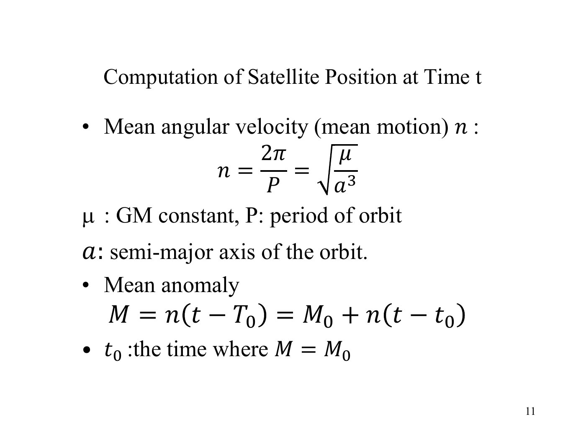
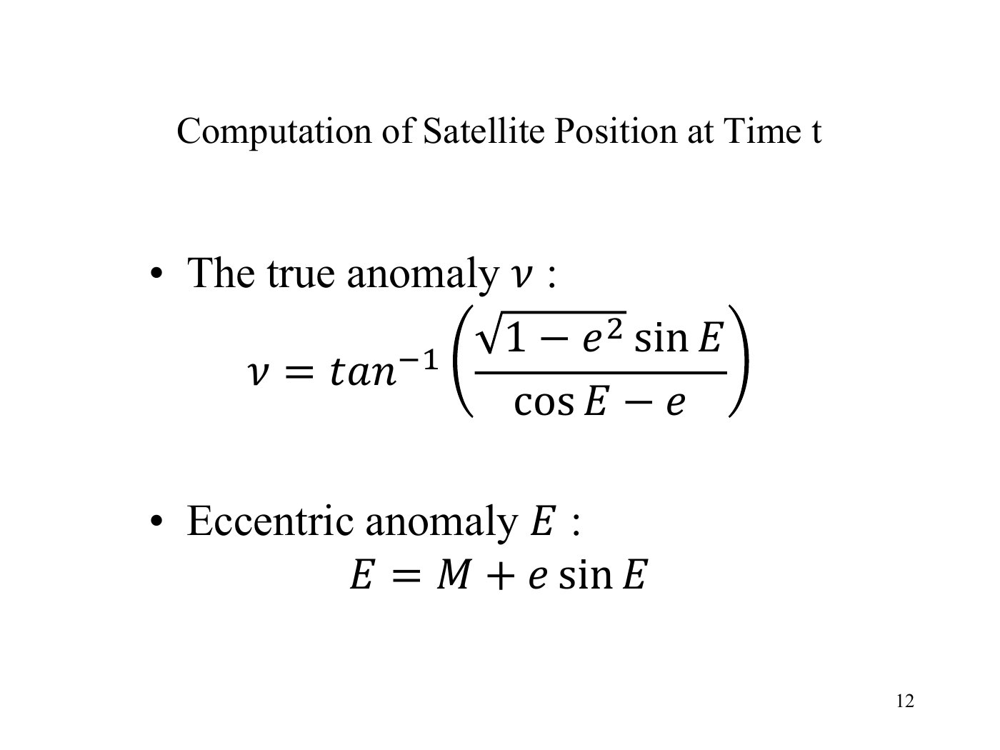
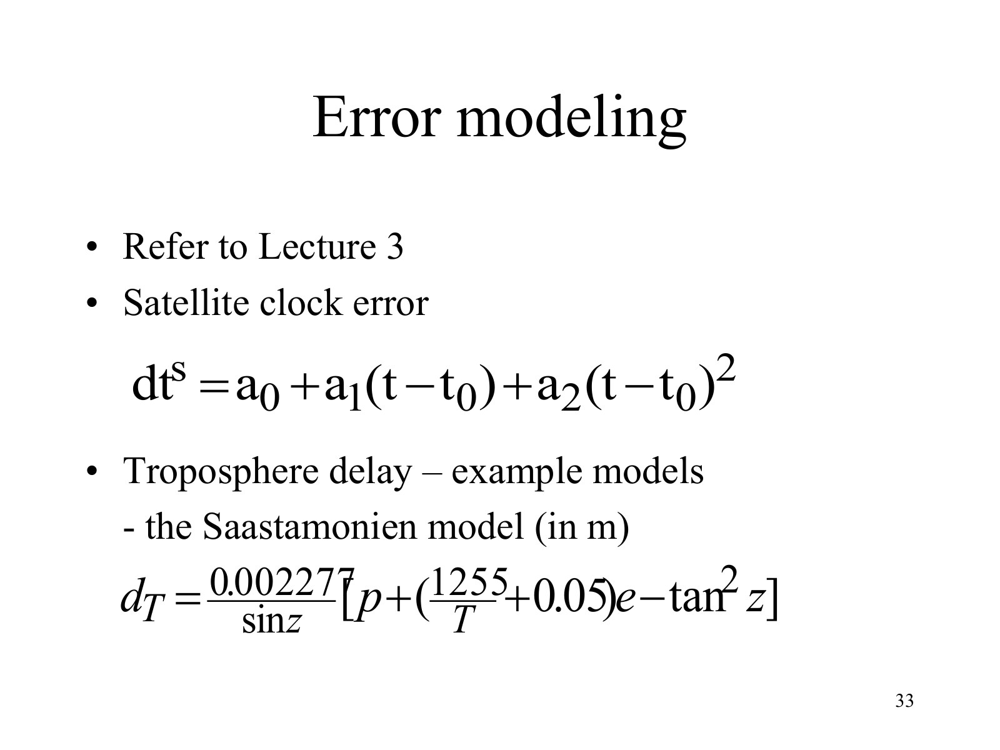
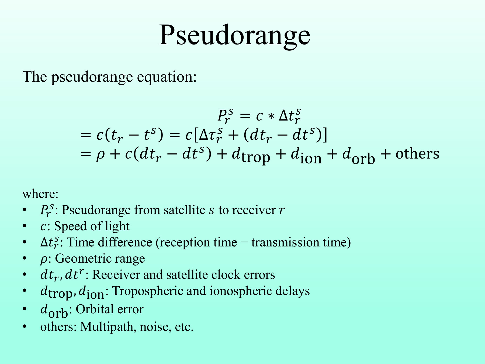
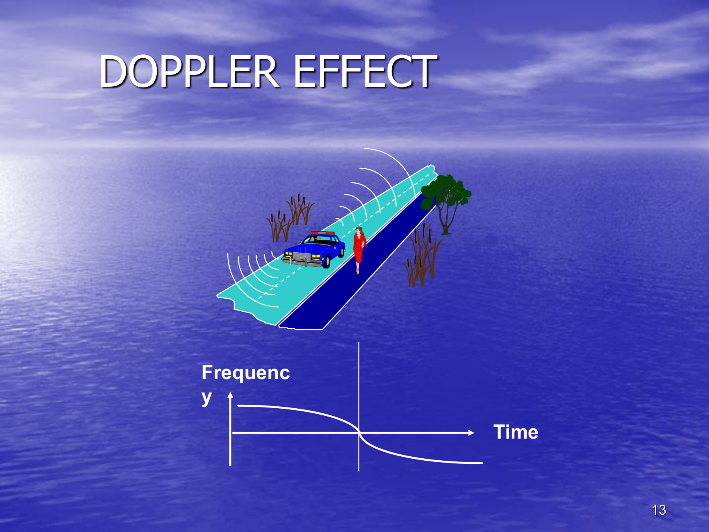

# 从卫星信号到接收机坐标：我对 GPS 定位过程的理解

**姓名：** 许云涛  
**学号：** 26109261g  
**课程：** LSGI533  

## 目录

- [1. 定位问题的出发点](#introduction)
- [2. GPS 轨道坐标计算与卫星钟差算法](#orbit-clock)
- [3. GPS 观测方程：伪距、载波相位和多普勒](#observations)
- [4. 使用伪距测量的接收机定位算法](#receiver-positioning)
- [5. 我对整个 GPS 定位过程的理解](#understanding)
- [参考文献与 Markdown 来源](#references)

## 1. 我们到底要解决什么定位问题

学习这门课时，我想弄清楚的是：地面上的接收机只是收到了几颗卫星发来的信号，为什么最后就能算出自己的位置？要回答这个问题，光说“接收机与卫星测距离”还不够。我们还要知道距离是怎样测出来的，卫星在什么位置，以及两端的时钟有没有使用同一个时间标准。

我想沿着一次定位的过程，把这些问题连起来。先从信号如何提供距离入手，再解释怎样计算卫星位置和卫星钟差，接着讨论伪距、载波相位和多普勒分别测到了什么，最后说明怎样把多颗卫星的伪距观测变成接收机坐标。在我的理解中，只有看清这些步骤怎样相互依赖，课件中的公式才真正成为一个定位方法。

### 1.1 先从一条信号和一个距离开始

假设卫星在 GPS 时间 \(t_s\) 发出信号，接收机在 \(t_r\) 收到信号。在理想真空情况下，传播时间 \(\tau=t_r-t_s\) 对应距离 \(\rho=c\tau\)。如果卫星位置已知，这个距离就把接收机限制在以卫星为球心的一个球面上。这就是使用卫星信号定位的出发点：信号让我们获得到空间参考点的距离约束。

但实际接收机没有直接获得这个理想距离。它用两端的时间信息得到表观传播时间，再乘以光速，这个测量值叫伪距（pseudorange）。两端时钟不完全准确，信号还要经过大气，所以伪距与几何距离有差别；第3节会从码测量具体解释这种差别。

即使已经测到了伪距，我们还面临两个几何问题：卫星一直在运动，而且一个距离不能唯一确定位置。我先解决参考点的问题——信号发出时卫星到底在哪里；然后处理时间和观测中的误差，最后把多颗卫星提供的约束合起来求接收机位置。

### 1.2 先约定坐标和时间的含义

我们希望求出的，是地面接收机的位置，而卫星位置是用于定位的参考。位置可以用三个直角坐标表示，但坐标必须带有参考系才有意义。这里采用地心地固坐标系（Earth-Centred, Earth-Fixed，ECEF）。计算卫星与接收机之间的距离以前，必须统一参考系。ECEF 的原点在地球质心，\(Z\) 轴沿地球自转轴，\(X\)、\(Y\) 轴位于赤道平面并随地球旋转。GPS 定位使用的地球参考基准是 WGS 84。直角坐标 \(X,Y,Z\) 描述这个参考系中的位置，经度、纬度和椭球高则是同一位置的另一种表达。

时间也要使用同一套标准。我把钟差定义为“时钟读数减去 GPS 系统时间”。因此接收机钟差为正，表示接收机时钟走在前面。后面观测方程中的接收机钟差为什么是正号、卫星钟差为什么是负号，就可以从这个约定解释。

## 2. GPS orbit coordinate computation and satellite clock error algorithms

GPS 轨道坐标计算与卫星钟差算法

### 2.1 卫星不是天空中的固定点

为了把卫星当作参考点，我们需要知道它在发出信号时的坐标。广播星历并不是给出一个永远不变的 \(X,Y,Z\)，而是给出描述卫星运动的轨道参数。接收机利用这些参数，计算指定时刻的卫星位置。

课件的思路是先计算轨道平面内的位置，再把它旋转到三维地固坐标系。

我把广播星历（broadcast ephemeris）理解为一套“按时间计算卫星位置的参数”。它由卫星信号携带的广播电文提供，并不是接收机根据一条伪距反推出来的。这里的输入是有效星历和所需的 GPS 发射时刻，输出是该时刻的卫星坐标。星历给出了椭圆的大小、形状、方向和参考时刻的位置；算法负责将这些参数推进到我们真正需要的时刻。

这个步骤重要，是因为定位方程需要一个已知的参考点。伪距只能告诉我们接收机与卫星的距离关系，不能同时独立确定两端的位置。如果卫星参考坐标错了，接收机可能把这个错误吸收到自己的坐标和钟差中。因此，“知道卫星在哪”不是背景知识，而是接收机解算的直接输入。

### 2.2 从轨道参数得到轨道平面坐标

我先把计算分成“沿轨道走到哪里”和“这条轨道在空间怎样摆放”两件事。半长轴 \(a\) 描述椭圆大小，偏心率 \(e\) 描述它偏离圆的程度；近地点是卫星最接近地心的位置，升交点是卫星从赤道南侧穿到北侧的位置。有了这些几何含义，再看角度之间的转换就更容易理解。

在理想二体椭圆模型下，首先根据半长轴计算平均运动：

$$
n=\sqrt{\frac{\mu}{a^3}}
$$

这里 \(a\) 是轨道半长轴，单位为 \(\mathrm{m}\)；\(\mu=GM\) 是地球引力参数，单位为 \(\mathrm{m^3\,s^{-2}}\)。算出的 \(n\) 单位为 \(\mathrm{rad\,s^{-1}}\)。平近点角随时间推进：

$$
M=M_0+n(t-t_0)
$$

**图1。** 原课件中的平均运动和平近点角，来源：Lecture 4，第11页。

平近点角适合表示时间推进，但还不是卫星在椭圆轨道上的实际角位置。因此还需要求解开普勒方程：

$$
E-e\sin E=M
$$

这里 \(e\) 是无量纲的偏心率，\(M_0\) 是参考时刻 \(t_0\) 的平近点角，三角函数中的角度统一用弧度。椭圆轨道上的角速度不是恒定的，平近点角均匀推进，而偏近点角 \(E\) 将这个时间描述连接到椭圆上的位置。

可以从 \(E_0=M\) 开始，用牛顿法迭代：

$$
E_{k+1}=E_k-\frac{E_k-e\sin E_k-M}{1-e\cos E_k}.
$$

当改变量和方程残差足够小时停止。随后计算：

$$
\nu=\operatorname{atan2}\left(\sqrt{1-e^2}\sin E,\cos E-e\right),\quad
u_0=\nu+\omega,\quad r_0=a(1-e\cos E).
$$

真近点角 \(\nu\) 表示从近地点量起的实际轨道角度；近地点幅角 \(\omega\) 说明近地点相对于升交点的位置，所以 \(u_0\) 就是从升交点量到卫星的轨道平面内角度。\(\operatorname{atan2}\) 使用两个输入，可以保留正确的角度象限。

**图2。** 原课件中的真近点角和偏近点角，来源：Lecture 4，第12页。

**图3。** 原课件中的升交距角、轨道半径和轨道平面坐标，来源：Lecture 4，第13页。

### 2.3 为什么理想椭圆还需要广播参数改正

椭圆解释了基本几何，但实际轨道存在摄动。因此 GPS 广播的是修正后的开普勒参数，还包括平均运动改正和谐波改正。广播计算中使用 \(a=(\sqrt A)^2\)、\(t_k=t-t_{oe}\)、\(n=n_0+\Delta n\) 和 \(M=M_0+nt_k\)，其中 \(t_{oe}\) 是星历参考时刻。接近 GPS 周界时，还要正确处理跨周时间差。

这里 \(n_0=\sqrt{\mu/a^3}\) 是前面的理想平均运动，\(\Delta n\) 是广播的平均运动改正。求出 \(E\) 和 \(u_0\) 后，计算：

$$
\begin{aligned}
\delta u&=C_{us}\sin 2u_0+C_{uc}\cos 2u_0,\\
\delta r&=C_{rs}\sin 2u_0+C_{rc}\cos 2u_0,\\
\delta i&=C_{is}\sin 2u_0+C_{ic}\cos 2u_0.
\end{aligned}
$$

然后得到 \(u=u_0+\delta u\)、\(r=r_0+\delta r\)、\(i=i_0+\dot i\,t_k+\delta i\)，轨道平面坐标为 \(x=r\cos u\)、\(y=r\sin u\)。半径改正系数的单位是米，升交距角和倾角改正系数则是角量。在我的理解中，这些是在基本椭圆上加入改正，没有改变定位的基本原理。前面的截图展示课件的基础几何，这里展开的广播算法步骤来自课程教程。

### 2.4 从轨道平面坐标转换到 ECEF 坐标

轨道平面中的坐标还不是接收机定位时使用的最终坐标。还要根据轨道倾角 \(i\) 和升交点方向角 \(\Omega\) 进行旋转；在广播 ECEF 算法中，后者必须使用地固升交点经度，而不能直接使用惯性参考系中的赤经：

$$
\begin{aligned}
X&=x\cos\Omega-y\cos i\sin\Omega,\\
Y&=x\sin\Omega+y\cos i\cos\Omega,\\
Z&=y\sin i
\end{aligned}
$$

**图4。** 原课件中的三维坐标旋转，来源：Lecture 4，第14页。

GPS 广播坐标计算中的升交点经度还要包含地球自转：

$$
\Omega=\Omega_0+(\dot\Omega-\omega_e)t_k-\omega_e t_{oe}.
$$

其中 \(\Omega_0\) 是广播的参考升交点参数，\(\dot\Omega\) 是其变化率；\(\omega_e\) 是地球自转角速度，与近地点幅角 \(\omega\) 不同。\(\dot i\) 则是倾角变化率，\(i_0\) 是参考倾角。各变化率使用弧度每秒，与秒制时间差配合。只有旋转公式还不够，升交点角度本身也要符合所使用的参考系。

还有一个时间细节：卫星坐标对应发射时刻，接收机坐标对应接收时刻。传播期间地球会旋转，所以计算距离以前，还要把卫星向量表示在接收时刻的 ECEF 坐标轴下。这一步是传播时间内的坐标轴旋转，与广播升交点经度中的地球自转项是两件事（Lecture 4，第21页）。

在我看来，这里最重要的是：卫星坐标既和时间有关，也和坐标参考系有关。只有卫星和接收机使用同一个 ECEF 参考系，二者之间的几何距离才有意义。

到这里，轨道算法的逻辑可以串起来了：用发射时刻与星历参考时刻之差推进平近点角，通过开普勒方程找到椭圆上的位置，再加上广播改正，最后根据轨道方向和地球自转转到共同的 ECEF 坐标轴下。我的理解是，这一串角度转换都在服务同一个目的：把电文中的轨道描述变成定位方程可以直接使用的三个坐标。

### 2.5 卫星钟差算法

知道卫星在哪里还不够。接收机要根据卫星发射时间和接收机接收时间估计信号传播时间。卫星钟只要有很小的误差，乘以光速以后就会变成明显的距离类误差。例如 \(1\,\mu\mathrm{s}\) 大约对应 \(300\,\mathrm{m}\)。

卫星虽然使用高稳定度时钟，时钟读数仍不等于完全准确的 GPS 系统时间。这里要区分两件事：轨道误差使参考点的位置不准确，钟差则使信号的时间标签不准确。即使轨道完全正确，错误的发射时间标签仍会使测得的距离出现偏差，也可能使轨道计算选错时刻。

广播电文给出钟参数，因此接收机可以先估计卫星钟差；它与接收机钟差的处理不同，后者要和接收机位置一起求解。卫星钟模型可以写成：

$$
\delta t_s=a_{f0}+a_{f1}(t-t_{oc})+a_{f2}(t-t_{oc})^2+\Delta t_{\mathrm{rel}}
$$

其中 \(t_{oc}\) 是钟参考时刻。\(a_{f0}\) 是钟偏，单位为秒；\(a_{f1}\) 是一次项系数，单位为 \(\mathrm{s\,s^{-1}}\)；\(a_{f2}\) 是二次项系数，单位为 \(\mathrm{s\,s^{-2}}\)。将所需时刻代入后，就得到以秒表示的钟差。相对论改正为：

$$
\Delta t_{\mathrm{rel}}=F e\sqrt A\sin E.
$$

其中 \(F\) 是 GPS 规定常数。这个式子使用了轨道计算中已经求出的偏近点角 \(E\)，所以轨道和钟差算法还共用一个中间结果。截图展示多项式部分，相对论项在这里根据课程教程展开。基本 GPS 码观测改正中，广播群延迟参数（TGD）还要按所用信号及钟定义处理。

**图5。** 原课件中的卫星钟差模型，来源：Lecture 4，第33页。

我把这三个多项式项理解为：参考时刻已经偏了多少、这个偏差正在以多快的速度变化、变化率本身是否还在变化。这里的 \(a_{f2}\) 就是广播的二次项系数，不能不加说明地把它直接当作钟差的二阶导数。相对论项再补上与椭圆运动有关的周期性影响。

实际计算时，我会先选取对应的钟参数和 \(t_{oc}\)，计算发射时刻相对于钟参考时刻的秒数差，代入多项式，并使用轨道计算的 \(E\) 求相对论项。注意 \(t_{oc}\) 与轨道的 \(t_{oe}\) 用途不同，不能默认互换；时间差也要正确处理周界。所得 \(\delta t_s\) 是秒，而 \(c\delta t_s\) 才是米。

钟差计算有两个相连的用途。第一，若卫星钟的发射标签为 \(t_{s,\mathrm{clk}}\)，则 GPS 发射时间为 \(t_s=t_{s,\mathrm{clk}}-\delta t_s\)，供轨道计算使用。第二，伪距观测方程含有 \(-c\delta t_s\)，因此改正伪距时要加回 \(c\delta t_s\)。这是把同一个时钟模型用于时间换算和观测建模，并不是随意对距离改正两次。

在我的理解中，轨道算法与钟差算法必须配合：前者给出参考点的位置，后者让该位置和测距观测对应到正确的时间。

## 3. GPS observation equations: pseudorange, carrier phase, and Doppler

GPS 观测方程：伪距、载波相位和多普勒

现在卫星端的位置和时间有了计算方法，我再回到信号本身：接收机实际得到哪些数字？这里是讲解顺序；实际接收机会先接收或持续跟踪信号，计算卫星状态时已经有观测数据。GPS 的三种观测量是伪距、载波相位和多普勒。观测方程的作用，是把接收机输出的测量值与我们要估计的几何量联系起来，并区分哪些项可改正、哪些项要估计、哪些误差只能暂时保留。在我的理解中，它们是对同一个信号传播过程的三种不同观察方式。

### 3.1 伪距是什么，为什么它不等于真实距离

**伪距（pseudorange）是接收机通过测距码得到的表观信号传播时间乘以光速，单位是米。** 它看起来像接收机到卫星的距离，但包含两端时钟偏差、传播延迟和测量误差，所以称为“伪距”，不能直接把它等同于几何距离。

它不是用尺量出来的。每颗卫星发出可识别的测距码，接收机在本地生成同一套码，移动本地码的时间位置，寻找与收到的码最匹配的对齐位置，这个过程叫码相关（code correlation）。码本身周期重复，所以还要结合信号中的时间信息确定对应的发射时刻。这样接收机才获得一个表观的发射—接收时间差。

先忽略硬件偏差、噪声和大气，设真实 GPS 发射、接收时间分别为 \(t_s,t_r\)。两端时钟读数分别为 \(t_s+\delta t^s\) 和 \(t_r+\delta t_i\)，因此：

$$
\begin{aligned}
P_i^s
&=c\left[(t_r+\delta t_i)-(t_s+\delta t^s)\right]\\
&=c(t_r-t_s)+c(\delta t_i-\delta t^s)\\
&=\rho_i^s+c(\delta t_i-\delta t^s).
\end{aligned}
$$

这就解释了伪距与真实距离之间最基本的差别。把大气传播和模型误差加回来，得到课件讨论的形式：

$$
P_i^s=\rho_i^s+c(\delta t_i-\delta t^s)+T_i^s+I_i^s+d_{\mathrm{orb}}+\varepsilon_P
$$

**图6。** 原课件中的伪距观测方程，来源：Lecture 2，第44页。

这里 \(\rho\) 是几何距离，\(c\) 是光速，\(\delta t_i\) 和 \(\delta t^s\) 分别是接收机钟差和卫星钟差，\(T\) 和 \(I\) 分别是对流层和电离层延迟，\(\varepsilon_P\) 包括噪声、多路径和其他未建模误差。因此，伪距并不完全等于物理距离，而是包含多种误差的距离类观测量。

按前面的钟差约定，表观传播时间包含 \(\delta t_i-\delta t^s\)：接收机钟走快会增大伪距，而卫星钟走快会增大发射时间标签，从而减小伪距。\(d_{\mathrm{orb}}\) 表示使用不完美卫星坐标带来的距离影响。如果 \(\rho\) 定义为基于真实轨道的距离，这一影响就应归入建模误差，不能重复计算。

大气又带来新的问题。电离层对码观测产生与频率有关的延迟，双频观测可以消除一阶影响的大部分；中性大气也会延迟信号，需要对流层模型。反射信号形成多路径，会经过额外路径并干扰跟踪。因此，仅改正钟差，还不能把伪距变成精确距离（Lecture 3）。

式中的下标 \(i\) 指接收机，上标 \(s\) 指卫星，所有项都以米表示。例如，在只考虑接收机钟差的教学情形中，若几何距离为 \(20\,200\,000\,\mathrm{m}\)，接收机钟快了 \(1\,\mu\mathrm{s}\)，那么伪距约为 \(20\,200\,300\,\mathrm{m}\)。多出来的约 \(300\,\mathrm{m}\) 并不是空间距离真的增加了，而是时钟读数造成的。这也说明，测量可以很稳定，却仍带有共同钟偏。

在我的理解中，伪距的重要性在于：它提供了可以直接进入绝对位置解算的距离类约束，不需要先确定载波的整数周数。但它只给出一个包含误差的约束，而不是现成坐标。后面要把各颗卫星的伪距一起使用，同时求出位置和接收机钟偏。

### 3.2 载波相位：精度高但存在模糊度

伪距已经能提供定位约束，但码测量的噪声限制了精度。那么，能不能利用同一信号中更细的变化？接收机还可以跟踪载波的相位。载波相位（carrier phase）测量的是接收载波相对于接收机本地产生载波的相位关系，接收机还会在连续跟踪时累积相位变化。一周对应一个波长，所以将以周表示的相位乘以波长，就能把它变成距离单位。但单次相位比较只能辨认周期内的位置，不能独自告诉我们完整周数。

因此，它的方程保留了伪距中的几何、时钟和对流层部分，同时加入未知的整周项，并改变电离层项的符号。把它表示成米，一个常见模型是：

$$
\lambda\phi_i^s=\rho_i^s+c(\delta t_i-\delta t^s)+T_i^s-I_i^s-\lambda N_i^s+B_\phi+\varepsilon_\phi
$$

**图7。** 原课件中的载波相位观测方程，来源：Lecture 2，第51页。

在我的理解中，载波波长很短，所以相位跟踪可以非常精确。但是接收机一开始不知道卫星和接收机之间已经传播了多少个完整的载波周期，这就是整数模糊度 \(N\)。如果发生周跳，连续跟踪也会被打断。因此载波相位精度高，但需要额外处理模糊度和数据质量。

这里 \(\phi\) 的单位是周，\(\lambda\) 是波长，单位为 \(\mathrm{m/cycle}\)，所以 \(\lambda\phi\) 的单位是米。\(B_\phi\) 汇总相位硬件偏差，\(\varepsilon_\phi\) 汇总残余误差；模糊度采用课件的 \(-\lambda N\) 约定。连续跟踪期间 \(N\) 保持不变，因此相位差能揭示很小的距离变化；失锁则可能破坏这个整数连接。

电离层项也从码观测的 \(+I\) 变成了相位观测的 \(-I\)：电离层使码的群传播延迟，却使载波相位超前。这不是信息超光速传播，而是码与载波对色散介质的响应不同。

例如，同一个周期内相位可以对应 \(N\) 周加一小部分，也可以对应 \(N+1\) 周加同样的一小部分；只看这一小部分，无法区分两个距离。短波长让细小变化容易被测出，却不会自动消除这个整周不确定性。在我的理解中，载波相位不是“更准确的伪距”这么简单：要把它用于精密位置解算，必须引入并处理每条连续卫星跟踪弧段的模糊度。连续时间差中，恒定整周项可以相消；但周跳后必须重新处理。

### 3.3 多普勒：距离变化率观测

前面关注的是距离及其相位表达。如果还想知道卫星与接收机之间的距离正在怎样变化，就可以看接收载波频率相对于标称频率的偏移，即多普勒。在一种常用符号约定下，可以写成：

$$
D_i^s\approx-\frac{1}{\lambda}\left[\dot{\rho}_i^s+c(\dot{\delta t}_i-\dot{\delta t}^s)+\dot T_i^s-\dot I_i^s\right]
$$

**图8。** 原课件中的多普勒效应示意图，来源：Lecture 1，第13页。上面的完整观测方程依据课程教程展开。图中声源接近时接收频率较高，远离时较低；下方曲线示意频率相对于基准的变化。

多普勒主要描述距离变化率，而不是绝对距离。几何距离变化率是卫星和接收机相对速度在视线方向上的投影。因此，一条多普勒观测不能单独确定完整的三维速度。实际使用时还必须查清接收机或 RINEX 文件采用的正负号约定。

上面的点号表示对时间求导。距离变化率的单位是 \(\mathrm{m\,s^{-1}}\)，除以波长后成为 \(\mathrm{cycle\,s^{-1}}\)，也就是 Hz。若 \(\mathbf{u}\) 从接收机指向卫星，则 \(\dot\rho=\mathbf{u}^{T}(\mathbf{v}_s-\mathbf{v}_r)\)。按这里的约定，距离增加对应负的几何多普勒。即使接收机静止，卫星运动仍然会产生多普勒。

多普勒方程也能从相位方程理解。若连续跟踪且 \(N\) 不变，对相位方程求时间导数，\(\lambda N\) 的导数为零；几何距离变成距离变化率，钟差变成钟漂。按这里采用的频率符号约定，\(D=-\dot\phi\)，就得到上面的主要项。这个简化式忽略了相位硬件偏差的变化和测量噪声，因此是近似模型。

我觉得多普勒的重要性，是把“现在相隔多远”补充成“现在正在怎样接近或远离”。如果卫星位置与速度已知，多颗卫星的多普勒还可共同估计接收机三维速度和接收机钟漂，但一条观测只有一个视线方向约束。它可以辅助运动和跟踪判断，却不能把单个频移直接当成一个绝对距离。

这三种观测满足不同需要。码观测提供初始绝对位置；载波相位在处理模糊度以后支持更精密的定位，第6讲继续展开这一点；多普勒描述几何随时间的变化，可以支持速度估计。下面按老师要求用伪距讲接收机位置解算。载波相位和多普勒仍是整个测量故事的一部分，但不能原封不动地代入只使用码观测的模型。

三种观测量的作用可以总结为：

| 观测量 | 在我的理解中主要提供的信息 | 主要限制 |
|---|---|---|
| 伪距 | 绝对距离类约束 | 噪声和大气影响较大 |
| 载波相位 | 高精度的相位距离变化 | 整数模糊度和周跳 |
| 多普勒 | 视线方向上的距离变化率 | 符号约定和钟漂 |

## 4. Receiver positioning algorithms using pseudorange measurements

使用伪距测量的接收机定位算法

### 4.1 为什么一颗卫星不够

如果已知一颗卫星的位置和一个精确距离，接收机只能位于以卫星为球心的球面上。一条观测只能提供一个几何约束，不能唯一确定三维位置。

接收机位置有三个未知坐标。另外，接收机时钟和 GPS 时间并不完全同步，所以接收机钟差也是未知量：

$$
\mathbf{x}=\begin{bmatrix}X_r&Y_r&Z_r&b_r\end{bmatrix}^{T},
\qquad b_r=c\delta t_r
$$

这样共有四个主要未知量，所以通常至少需要四颗几何上独立的卫星。每颗卫星有自己的位置和钟差模型，而接收机坐标与钟偏由这些观测共同估计。这也解释了为什么要把多颗卫星的方程放在一起，而不是每颗卫星各算一个接收机位置。

### 4.2 建立改正后的伪距方程

对每颗卫星，接收机把实测伪距、计算得到的卫星坐标、卫星钟差改正以及可用的大气改正结合起来。简化后可以写成：

$$
P^s_{\mathrm{corr}}=\rho^s(X_r,Y_r,Z_r)+b_r+\varepsilon^s_{\mathrm{res}}
$$

**图9。** 原课件中的伪距定位方程，来源：Lecture 4，第31页。

具体说，令 \(P_{\mathrm{corr}}=P+c\delta t_s-T-I\)，其他可建模偏差也按相同约定处理。卫星钟项在原观测中是负号，所以改正时要加回去。接收机钟偏则保留为未知量，因为同一接收机同一时刻的各颗卫星观测共享它。\(\varepsilon^s_{\mathrm{res}}\) 表示剩余误差，单位为米；改正并不意味着每条观测都变成精确距离。

那么，接收机钟差还不知道，怎样先计算发射时刻？若接收时间标签为 \(t_{r,\mathrm{clk}}\)，先计算 \(t_{s,\mathrm{clk}}\approx t_{r,\mathrm{clk}}-P/c\)。因为伪距本身包含同一个接收机钟差，这样相减会抵消它，得到近似的卫星钟发射时间。再用 \(t_s=t_{s,\mathrm{clk}}-\delta t_s\) 转成 GPS 时间；卫星钟改正可在近似时刻计算并迭代细化。因此，不必先完全解出接收机钟差才能开始轨道计算。另一方面，高度角和大气改正依赖接收机位置，确实需要先用粗略位置启动，再随着解算更新。前面的分块说明依赖关系，实际算法则要反复检查这些量的一致性。

现在可以明确已知与未知：每颗卫星的输入是实测并改正后的伪距，以及已统一参考系的卫星坐标；共同未知量是接收机的三个坐标和一个米制钟偏。它们通过下面的距离关系连接：

$$
P_{\mathrm{corr}}^s=
\sqrt{(X_s-X_r)^2+(Y_s-Y_r)^2+(Z_s-Z_r)^2}
+b_r+\varepsilon_{\mathrm{res}}^s.
$$

这一步是整个故事的连接点：前面算卫星位置，是为了给平方根中的卫星坐标赋值；前面算卫星钟差和传播改正，是为了让方程左边更接近几何距离加接收机钟偏。接下来需要解决的，才是如何从这些方程中求出接收机状态。

### 4.3 对非线性距离方程进行线性化

几何距离中有平方根，所以方程是非线性的，不能直接将未知坐标当作线性方程组的系数来求解。接收机先给出一个近似状态 \((X_0,Y_0,Z_0,b_0)\)，计算近似距离，再求坐标和钟偏的小改正。

**图10。** 原课件中的非线性定位模型，来源：Lecture 4，第36页。

首先计算当前近似状态下的预测观测 \(\rho_0^s+b_0\)，再与实测值比较：

$$
\rho_0^s=\sqrt{(X_s-X_0)^2+(Y_s-Y_0)^2+(Z_s-Z_0)^2},\qquad
l_s=P_{\mathrm{corr}}^s-(\rho_0^s+b_0).
$$

\(l_s\) 就是“实测减计算”的差。接下来要问：接收机坐标和钟偏各改变一点，会让预测伪距改变多少？一阶泰勒展开用各变量的偏导数表示这种局部敏感程度。

从近似接收机位置指向卫星的单位视线向量为 \(\mathbf{u}^s=[X_s-X_0,Y_s-Y_0,Z_s-Z_0]^T/\rho_0^s\)。对距离公式分别求接收机三个坐标的偏导，就得到 \(-u_x^s,-u_y^s,-u_z^s\)；对米制钟偏求导得到 \(1\)。因此，一阶展开实际是在说：

$$
l_s\approx-u_x^s\Delta X-u_y^s\Delta Y-u_z^s\Delta Z+\Delta b+\varepsilon_{\mathrm{res}}^s.
$$

负号可以从几何上理解：接收机向卫星移动会缩短距离；而接收机钟偏增加，会增大所有卫星的预测伪距。把这四个系数收成一行，就得到设计矩阵的一行：

$$
\mathbf{G}_s=\begin{bmatrix}-u_x^s&-u_y^s&-u_z^s&1\end{bmatrix}.
$$

于是前面的展开可以简写为 \(l_s\approx\mathbf{G}_s\Delta\mathbf{x}+\varepsilon_{\mathrm{res}}^s\)。这里的设计矩阵不是额外测量值，而是由当前卫星—接收机几何计算出来的。

我的理解是，线性化把“直接寻找未知坐标”暂时变成“判断当前猜测应该向哪里改”。它只保留局部的一阶变化，忽略更高阶项，所以求出的改正需要加回原状态，再重新计算。初始猜测太差、几何太差或观测含有严重错误时，不能保证迭代成功。

### 4.4 卫星多于四颗时使用最小二乘

当卫星数大于四颗时，由于测量噪声，所有方程通常不能完全同时满足。加权最小二乘通过最小化加权残差来估计改正量：

$$
\widehat{\Delta\mathbf{x}}=(\mathbf{G}^{T}\mathbf{W}\mathbf{G})^{-1}\mathbf{G}^{T}\mathbf{W}\mathbf{l}
$$

**图11。** 原课件中的最小二乘解算内容，来源：Lecture 4，第40页。

每颗卫星贡献一行，把它们叠起来就得到 \(\mathbf{l}\approx\mathbf{G}\Delta\mathbf{x}\)。其中 \(\Delta\mathbf{x}=[\Delta X,\Delta Y,\Delta Z,\Delta b]^T\)。最小二乘选择使 \((\mathbf{l}-\mathbf{G}\Delta\mathbf{x})^T\mathbf{W}(\mathbf{l}-\mathbf{G}\Delta\mathbf{x})\) 最小的改正量。因此，它是在所选误差模型下寻找最佳拟合，不能消除所有误差。求解后更新 \(\mathbf{x}_{k+1}=\mathbf{x}_k+\widehat{\Delta\mathbf{x}}\)，再重新计算几何。

如果有 \(m\) 颗可用卫星，\(\mathbf{G}\) 就是 \(m\times4\) 矩阵，\(\mathbf{l}\) 有 \(m\) 个分量，待求改正量有四个分量。令目标函数对改正量的导数为零，得到正规方程：

$$
\mathbf{G}^T\mathbf{W}\mathbf{G}\,\widehat{\Delta\mathbf{x}}
=\mathbf{G}^T\mathbf{W}\mathbf{l}.
$$

前面的解式由此得到，条件是矩阵具有足够的秩。恰好四条独立观测时，可以解四个局部未知量，但缺乏多余观测来检查拟合；多于四条时，最小二乘让我们利用这些多余约束。在我的理解中，它的重要性是让带噪声、无法精确相交的距离约束仍能给出一个共同估计，而不是强迫每颗卫星给出完全一致的答案。

权重矩阵表示不同观测的相对可靠程度。低高度角观测通常经过更长的大气路径，也更容易受到多路径影响，所以可以降低权重。在实际程序中，QR 或 SVD 通常比直接计算矩阵逆更稳定。

### 4.5 完整的伪距定位流程

我对完整算法的理解是：

1. 读取伪距观测和广播星历。
2. 选择初始接收机坐标和接收机钟偏，明确时间标签及钟差约定。
3. 由接收时间标签减去伪距除以光速，估计卫星钟的发射时间，再用卫星钟模型换算成 GPS 发射时间。
4. 计算该发射时刻的卫星坐标，并将其转换到接收时刻的 ECEF 坐标轴下。
5. 根据当前接收机位置计算卫星高度角，进行电离层、对流层及信号相关偏差改正，建立改正后的观测。
6. 根据当前坐标和钟偏计算预测伪距，与实测值比较。
7. 建立线性化设计矩阵和残差向量。
8. 用最小二乘求坐标和钟差改正量。
9. 更新接收机状态，重复第3–8步，保证时间、几何和改正一致。
10. 改正量足够小则停止迭代；若不收敛或达到迭代次数上限，标记求解失败。残差另作质量检查，不要求其消失。
11. 检查卫星几何、矩阵秩、残差、坐标参考系和数据质量。

信号发射时刻非常重要，因为信号传播期间卫星仍然在运动。如果只使用接收时刻的卫星坐标，卫星位置和传播距离之间就不一致。

### 4.6 得到一个坐标，还不等于证明它准确

四颗卫星只是方程数量上的最低要求。如果它们的方向很相似，几何关系就很难区分不同坐标方向的变化。精度衰减因子（Dilution of Precision，DOP）描述这种几何如何放大观测不确定度；它是无量纲因子，不是以米表示的位置误差（Lecture 4，第42–48页）。

我会检查迭代是否收敛、拟合后的残差是否合理，但残差小本身不能证明位置准确，因为一些系统误差可能被估计状态吸收。有独立参考坐标时，还应进行外部比较。最终 ECEF 坐标可以转换成经度、纬度和 WGS 84 椭球高；椭球高不能直接称为海拔。

如果剩余误差仍然太大，后面的课程介绍了进一步的帮助方法。已知位置的参考接收机可以为附近用户估计改正，因为部分卫星和大气误差具有相关性。差分和增强方法（第4、5讲）改进这条基本处理链；载波相位方法（第6讲）通过处理额外未知量追求更高精度。它们仍然建立在有效观测、统一时间和共同参考系之上。

## 5. 我对整个 GPS 定位过程的理解

把课程中与 GPS 定位有关的内容联系起来以后，我的理解是：接收机先从信号中取得观测和广播参数，再用相互关联的轨道、时钟及传播模型解释这些观测。统一时间和参考系以后，多颗卫星提供的伪距约束才能共同用于估计接收机坐标与钟差。更新估计后再检查模型，直到得到收敛且通过质量检查的结果。

在我看来，三种观测量不能互相替代。伪距提供实用的绝对距离类约束；载波相位在处理模糊度以后可以提供更精细的相位信息；多普勒则提供视线方向上的运动信息。它们描述的是同一个信号的不同方面。

我最大的理解是，GPS 定位不是几个精确球面的简单求交，而是一个包含时间、卫星运动、坐标参考系、测量误差和卫星几何的估计问题。很小的时间误差会变成距离误差，轨道误差会改变定位几何，而较差的卫星几何会放大测量噪声。

## 参考文献

1. LSGI533 Lecture 2, *GPS Observables*，重点参考第44、51页。
2. LSGI533 Lecture 4, *PR Positioning*，重点参考第10–14、21、23–27、31、33、36–48页。
3. LSGI533 课程教程中关于 GPS 观测方程、广播星历、卫星钟差和伪距定位的章节。
4. LSGI533 Lecture 3, *Error Correction*，用于传播误差及其改正的解释。
5. LSGI533 Lecture 5, *GB/SB*，以及 Lecture 6, *High Precision Positioning*，用于单机码定位以外的简短延伸。

6. LSGI533 Lecture 1, *Introduction*，第13页，用于多普勒效应示意图。

### Markdown 来源说明

本报告涉及数学公式和专业符号，使用 Markdown 配合 LaTeX 记法更便于编写和维护，因此本 PDF 由 Markdown 源文件转换而来。报告的 Markdown 文件与所用课件截图已上传至 GitHub：[My Understanding of GPS Positioning](https://github.com/xuytwinter/My-Understanding-of-GPS-Positioning)。
